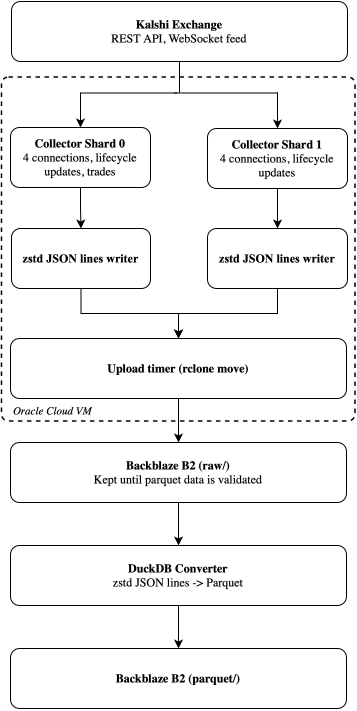

# Kalshi Pipeline

Kalshi does not publish historical orderbook data. Its API returns historical prices, but nothing about orderbook depth, queue position, or how resting orders were filled. A realistic backtest, and in particular a fill model, depends on exactly that information. This pipeline records every orderbook change on every open Kalshi market, around the clock, and converts the recordings into Parquet tables for backtesting.

## Flowchart

<picture>
  <source media="(prefers-color-scheme: dark)" srcset="docs/darkdiagram.svg">
  
</picture>

## Infrastructure

**Oracle Cloud Infrastructure**: The collector runs on an Always Free Arm instance with 2 OCPUs and 12 GB of memory, running Ubuntu 24.04 Minimal. The VM is in the US-East (Ashburn) region, the closest available region to Kalshi's exchange infrastructure in Columbus, which keeps network latency and the risk of falling behind the feed low.

**Backblaze B2**: A single bucket holds both the raw recordings and the converted Parquet tables. B2 was chosen for its low storage cost ($6.95 per TB per month on the pay-as-you-go plan), which matters at roughly 75 GB of compressed raw data on a busy day. Raw files are retained until the Parquet output has been validated against a backtester.

**Razer Blade 14**: Conversion runs on a Windows laptop rather than on the VM. The VM's two cores are already 55-70% busy with the collector, and a collector that falls behind loses data permanently, so all heavy processing happens elsewhere. A scheduled task on the laptop runs the converter nightly.

**Raspberry Pi** (planned): A fill model needs data with as few gaps as possible, and an extended outage of either the VM or B2 would leave holes that cannot be recovered later. A Raspberry Pi running a second, independent copy of the collector, with local storage as a fallback for B2, would protect against both. The two feeds can be merged afterwards using the exchange's message ordering.

## Collector Software

**Kalshi Exchange**: Kalshi offers two interfaces: a REST API for querying markets on request, and a WebSocket feed that pushes updates as they happen. When the collector subscribes to a market's orderbook channel, it gets a snapshot of the book followed by a live stream of every change (deltas). It never has to poll individual markets.

**Collector**: On startup, the collector requests the list of open markets from the REST API and subscribes to the orderbook feed of each one. Multivariate combo markets are excluded. It also subscribes to two exchange-wide channels: lifecycle updates, which announce infromation about market creation/settlement, and trade updates, which are a stream of every trade executed on the exchange. As a safety net, the collector repeats the full REST listing every 30 minutes and subscribes to any open market it has missed.

The collector runs as two shards, one process per CPU core. The system runs on a 2-core VM, the most available on Oracle Cloud's free tier. Each market is assigned to a shard by a hash of its ticker, and each shard has four WebSocket connections. Within a shard, a new market goes to whichever connection has the fewest markets, which keeps the load balanced. Connection zero of each shard also carries the lifecycle subscription, and each shard acts only on its own markets. Connection zero of shard zero also carries the trade subscription.

**Writer and Uploader**: Each shard writes every message it receives to a zstd-compressed JSON Lines file. Each line is tagged with a local receive timestamp and the connection the message arrived on. At the top of each UTC hour, the shard closes the current file and moves it to a staging directory. At ten minutes past each hour, a timer runs an rclone job that moves everything in the staging directory to a Backblaze B2 bucket.

Normally an upload is two files, one per shard, but it can be more. A shard that restarts mid-hour starts a new file for that hour, and files from a failed upload go with the next run. A local file is deleted only after it has been uploaded and its checksum verified.

## Converter Software

**Converter**: ...

**Writer and Uploader**: ...

## Test Suite

## CI/CD

